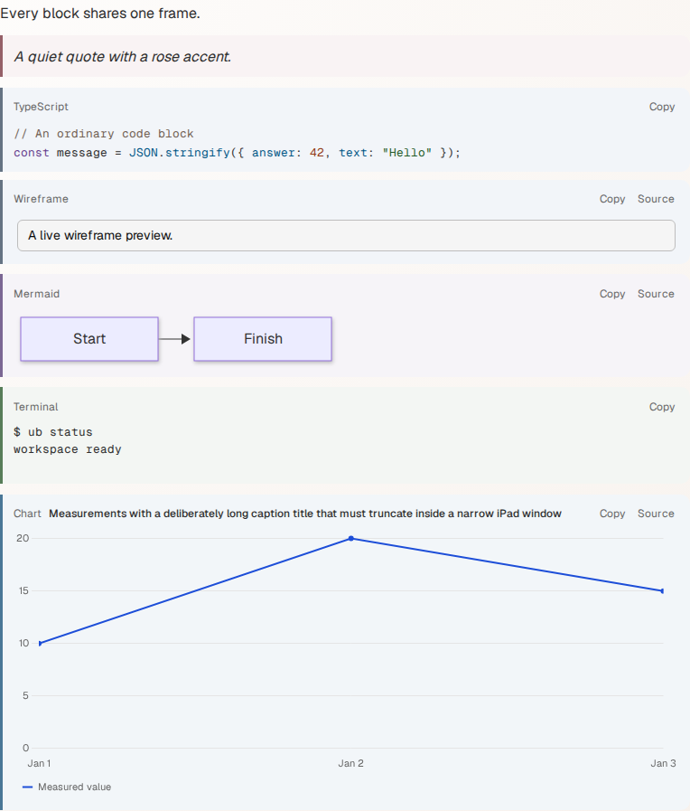
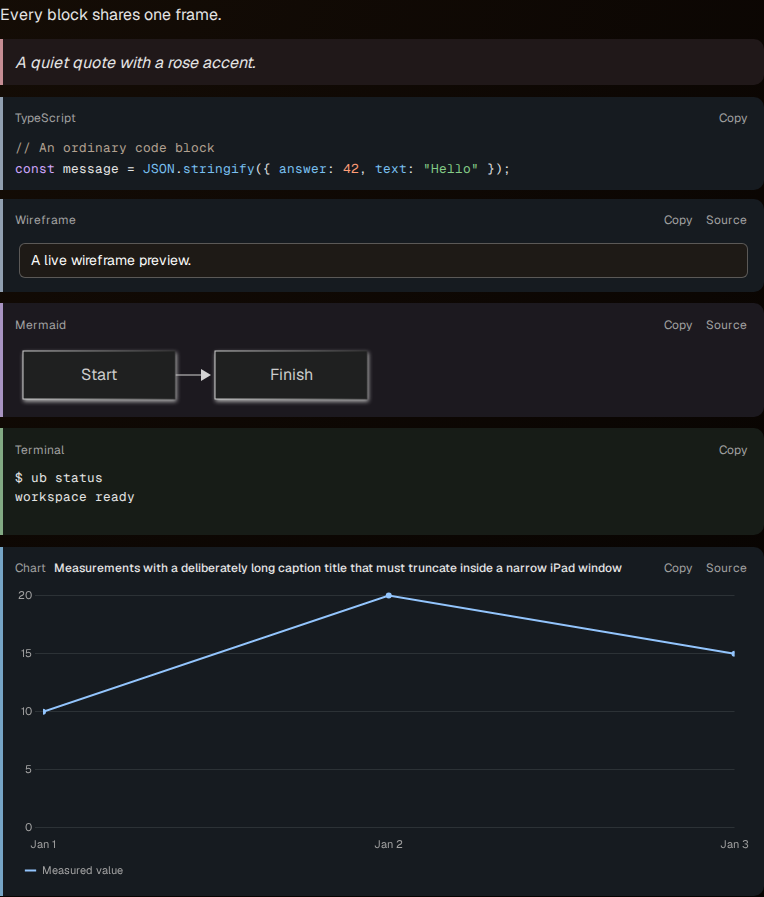
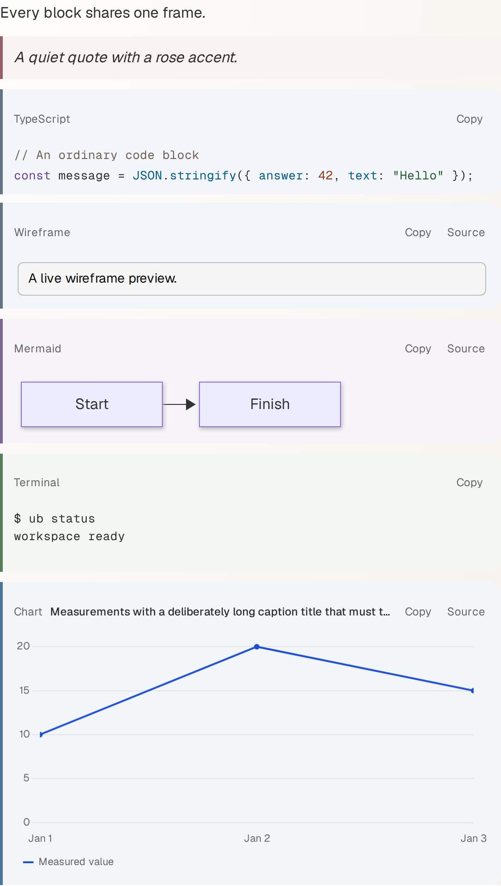
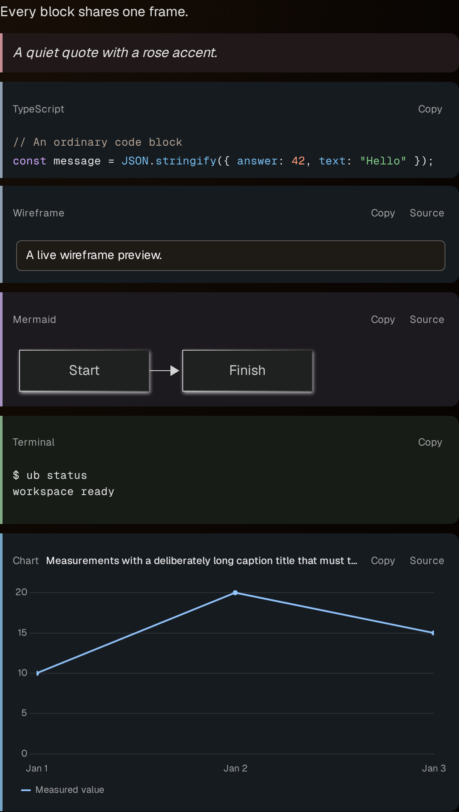

# Shared block frame browser evidence

The production `ub open` renderer shows quote, code, wireframe, Mermaid,
terminal and chart blocks together. Each fixture uses a separate MCP writer;
opening sources, copying and controlling playback leave the stored blocks
unchanged. The chart consumes document-owned measurements.

| Context | Light | Dark |
| --- | --- | --- |
| Desktop, 1366 px |  |  |
| Narrow iPad touch window, 600 px |  |  |

`block-frame.spec.ts` measures the shared bar, tint and corner shape, the
caption's containment and 12/16 UI type, and caption actions' touch targets.
It checks actual painted text in source and rendered views, controls at rest,
hovered and keyboard-focused, neutral focus rings, quote prose, terminal
transcripts, chart canvas ticks and legend, and wireframe and Mermaid problem
states. It measures every existing syntax token against the code tint.
Desktop source actions and playback use keyboard activation; iPad uses touch.
The tagged proof runs in Chromium and WebKit with explicit desktop and iPad
contexts in both appearances.
The comment proof flashes a real quote annotation, then reaches it by native
keyboard navigation. Its neutral focus ring survives the flash in normal and
reduced motion, and Enter returns to the matching comment card.

Regenerate the screenshots with the focused production-browser proof:

```sh
mise run e2e -- block-frame.spec.ts --project=chromium
```

The four attached screenshots are named `block-frames-desktop-light.png`,
`block-frames-desktop-dark.png`, `block-frames-ipad-narrow-light.png` and
`block-frames-ipad-narrow-dark.png`. Copy the fresh Chromium attachments into
this directory before another Playwright run clears `test-results`:

```sh
python3 -c 'from pathlib import Path; from shutil import copyfile; source = Path("packages/web/test-results"); target = Path("packages/web/e2e/evidence/block-frames"); names = ["desktop-light", "desktop-dark", "ipad-narrow-light", "ipad-narrow-dark"]; matches = {name: [path for path in source.rglob("block-frames-" + name + ".png") if path.parent.name.endswith("-chromium")] for name in names}; assert all(len(paths) == 1 for paths in matches.values()), matches; [copyfile(matches[name][0], target / (name + ".png")) for name in names]'
```

Run the paired WebKit proof with
`mise run e2e -- block-frame.spec.ts --project=webkit-ipad`.
