# Chart browser evidence

Synthetic editor fixtures rendered through an isolated production `ub open`
and a separate `ub mcp serve` writer. The chart specification regenerates these
screenshots and measures drawing from the browser's full data availability.
Its observers inspect the existing Yjs document without a product test hook.

| View | Light | Dark |
| --- | --- | --- |
| Two independently scaled units | 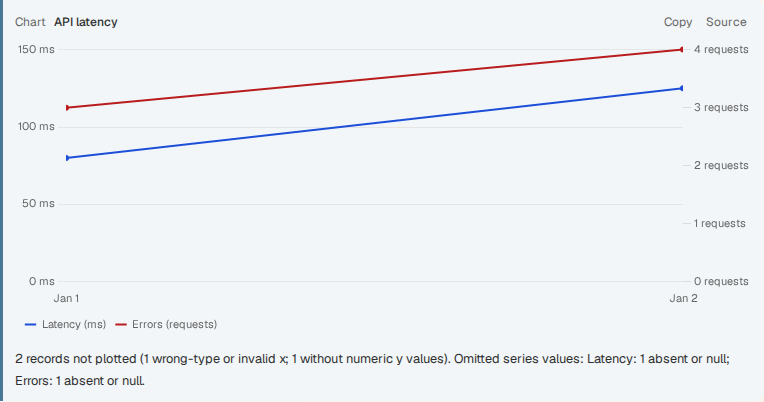 | 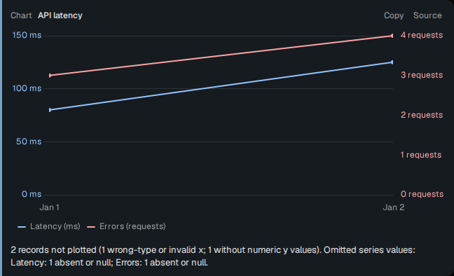 |
| Seven daily observations, desktop | 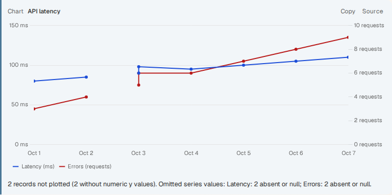 | 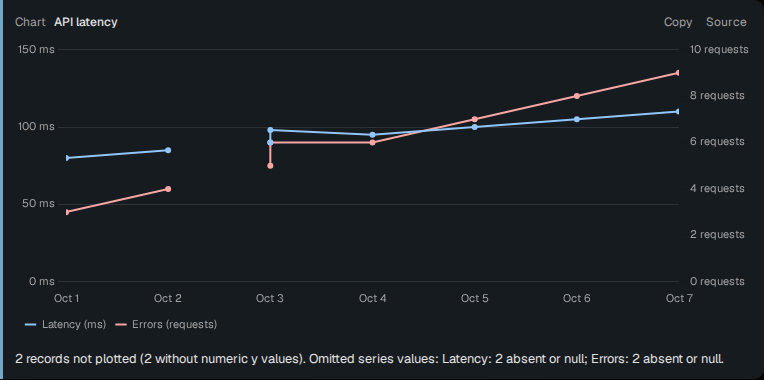 |
| Seven daily observations, iPad touch | 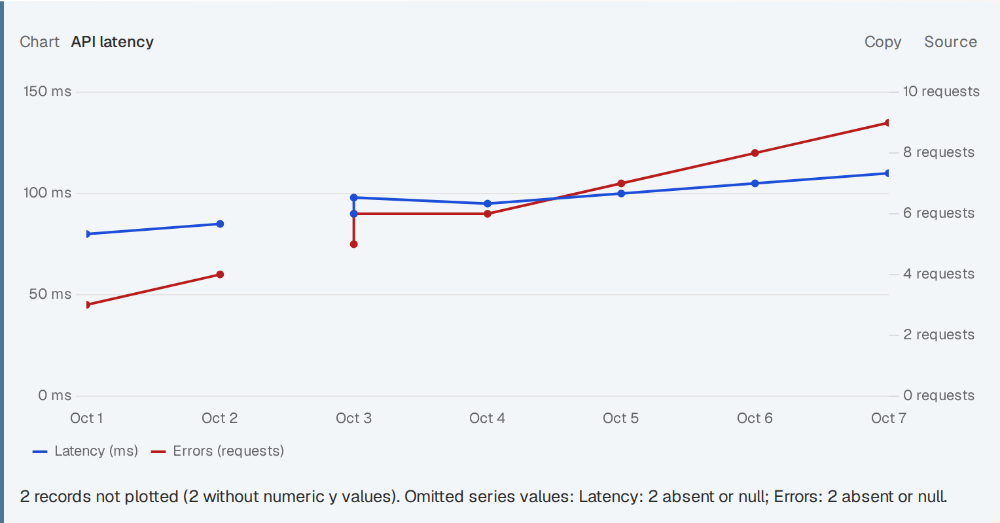 | 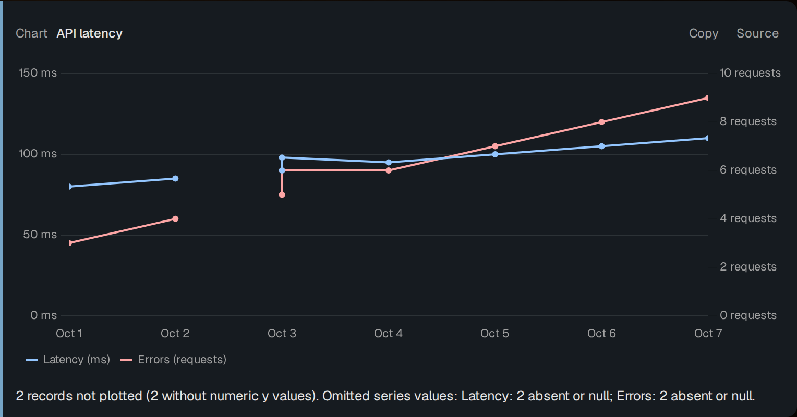 |
| 360 px, three percentage series | 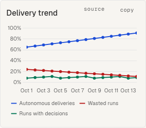 | 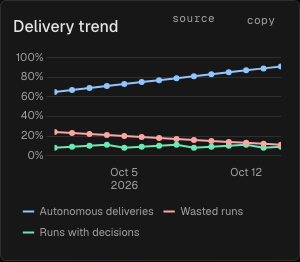 |
| Three percentage panels, document width | 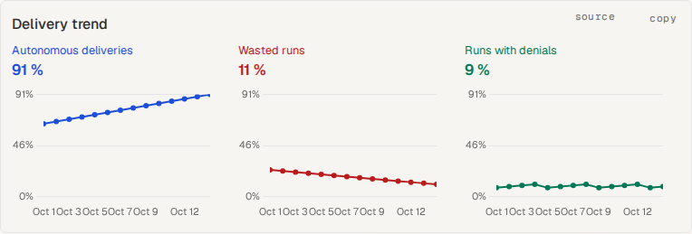 | 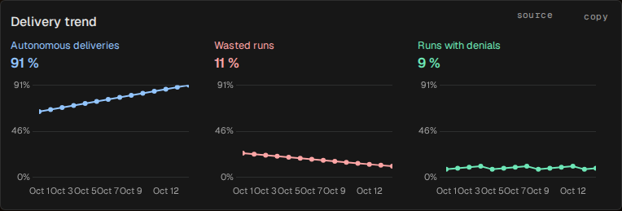 |
| Three percentage panels, 360 px | 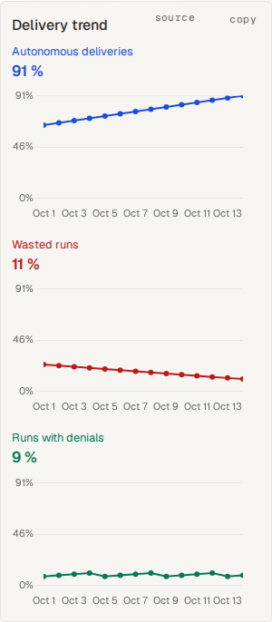 | 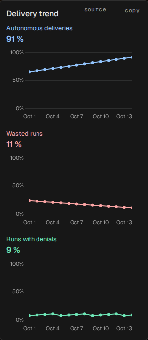 |

The browser suite covers source insertion and keyboard/pointer access, live
data and mapping updates, canvas names/descriptions, appearance changes, reopen,
problem recovery and content locks. Canvas observations check that date and
numeric labels anchor only at plotted observations, preserve continuous
spacing, and omit crowded labels only where they overlap retained labels.
The geometry probe resets on each canvas clear and measures painted text
extents, so previous draws cannot satisfy a current-layout assertion.
Daily labels are one month/day line in a single year; tied observations and
empty rows do not introduce time labels. Intraday labels retain UTC and day
context, and full tooltips stay unchanged. An omitted close pair leaves hourly
labels compact for both millisecond and microsecond source timestamps. Daily
endpoint glyphs stay inside 311–317 px canvases across responsive draws.
The desktop and explicit iPad touch
contexts run in both appearances, with paired Chromium and WebKit coverage.
The suite also checks legend placement, opposite-side unit ticks, the editor's
font, same-x tooltips for sparse series and a visible single-x point.
The compact controls are checked on charts, tables and empty chart panels.
Panel fixtures check one accessible image, ordered series headers, the latest
plotted tooltip values, an empty series, comparable unit-group ranges,
observation-only labels, per-panel hover, mapping/layout changes and zero
renderer writes. Equal-width percentage panels show matching labels and ticks
in both appearances, with at least 6 px between retained x labels; panel
canvases remain hidden from accessibility APIs. Independent point geometry
checks that each compact y label equals its gridline's value across rounded
positive and negative ranges, keeps tick text inside the canvas and leaves
headroom for the latest rising percentage marker.
Timing fixtures contain a 2.7 MB area with
4,400 records and a 365-record/three-series chart, plus 5,001 stored records
limited to the latest 5,000/eight series in both overlay and panels layouts.
Chromium uses a 1366×768 viewport,
en-US locale and twofold CPU throttling; the PR records the measured values and
the host class. Unit suites defend value semantics, non-destructive invalid
merges, zero renderer writes, frame coalescing, observer release and old-client
preservation.

The committed [representative timing capture](timing-representative.json) and
[5,000-record timing capture](timing-bound.json) were recorded on macOS Apple
Silicon with the suite's twofold Chromium CPU throttling. They are observations
from this host, not a cross-host performance guarantee.
The [5,000-record panels capture](timing-bound-panels.json) was recorded on
Linux x86_64 with an AMD EPYC-Genoa processor and the same twofold Chromium CPU
throttling. Its complete eight-panel block first drew in 645.6 ms; all ten
live redraws took 322.4–367.7 ms, with a 338.0 ms median.

Regenerate the chart screenshots, with shared-frame table regression coverage:

```sh
mise run e2e -- chart.spec.ts data-table.spec.ts --project=chromium
```

The tests attach cropped blocks named `chart-light.png`, `chart-dark.png`,
`chart-daily-desktop-light.png`, `chart-daily-desktop-dark.png`,
`chart-daily-ipad-light.png`, `chart-daily-ipad-dark.png`,
`chart-phone-light.png` and `chart-phone-dark.png`. Copy the fresh Chromium
attachments into the committed evidence (the command refuses missing or
ambiguous matches):

```sh
python3 -c 'from pathlib import Path; from shutil import copyfile; source = Path("packages/web/test-results"); target = Path("packages/web/e2e/evidence/chart"); files = {"chart-light.png": "light.png", "chart-dark.png": "dark.png", "chart-daily-desktop-light.png": "daily-desktop-light.png", "chart-daily-desktop-dark.png": "daily-desktop-dark.png", "chart-daily-ipad-light.png": "daily-ipad-light.png", "chart-daily-ipad-dark.png": "daily-ipad-dark.png", "chart-phone-light.png": "phone-light.png", "chart-phone-dark.png": "phone-dark.png"}; matches = {name: [path for path in source.rglob(name) if path.parent.name.endswith("-chromium")] for name in files}; assert all(len(paths) == 1 for paths in matches.values()), matches; [copyfile(matches[name][0], target / destination) for name, destination in files.items()]'
```

The paired desktop/iPad test is tagged for WebKit; it explicitly creates the
iPad context instead of treating a narrow desktop viewport as a touch device.
Phone-size screenshots retain design evidence through Chromium; phone WebKit
coverage is deferred. Run the supported desktop and iPad WebKit projects:
`mise run e2e -- chart.spec.ts --project=webkit-macbook --project=webkit-ipad`.
Copy the Chromium evidence before this second run, because Playwright clears
its prior output directory.

Run the isolated chart and data-table timing probes:

```sh
mise run e2e -- chart.spec.ts data-table.spec.ts --project=chromium-workload --no-deps
```

The shared gate records timings and
asserts complete data availability, successive live redraws and zero renderer
writes; host-dependent wall-clock timings do not fail it. To enforce the
recorded budgets on a benchmark host, run
`env UB_CHART_TIMING_BUDGETS=1 mise run e2e -- chart.spec.ts --project=chromium-workload --no-deps --workers=1`.
That opt-in requires representative first draw within 500 ms and median redraw
within 250 ms, plus bounded first draw, median and every redraw within 1,000 ms.
The panels variant enforces the same bounded budget for the complete block,
including all eight Chart.js instances.

Regenerate and copy the four panel screenshots with the chart suite above:

```sh
python3 -c 'from pathlib import Path; from shutil import copyfile; source = Path("packages/web/test-results"); target = Path("packages/web/e2e/evidence/chart"); names = ["panels-desktop-light", "panels-desktop-dark", "panels-phone-light", "panels-phone-dark"]; matches = {name: [path for path in source.rglob("chart-" + name + ".png") if path.parent.name.endswith("-chromium")] for name in names}; assert all(len(paths) == 1 for paths in matches.values()), matches; [copyfile(matches[name][0], target / (name + ".png")) for name in names]'
```

The timing test also attaches `chart-timing-bound-panels.json`; its ten live
redraws measure complete panel redraws rather than an individual canvas.
