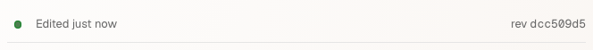
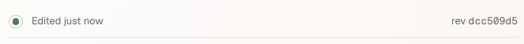
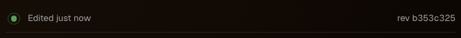
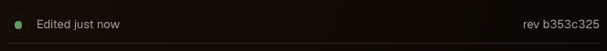

# Document sync ring frames

The header keeps its resting dot while a thin green ring expands and fades
over 650 ms. These frames sample the production CSS at 0, 250 and 500 ms in
Chromium. The animation is paused for sampling after the real outgoing,
incoming, reduced-motion and reconnect checks finish; no sync event is
fabricated for those checks.

| Appearance | 0 ms | 250 ms | 500 ms |
| --- | --- | --- | --- |
| Light |  |  |  |
| Dark |  |  |  |

Regenerate with `mise run e2e quiet-header.spec.ts`. Copy the Chromium
`sync-ring-0ms.png`, `sync-ring-250ms.png` and `sync-ring-500ms.png`
attachments from `packages/web/test-results` into this directory with the
appearance prefix. The same proof also runs on iPad WebKit.
