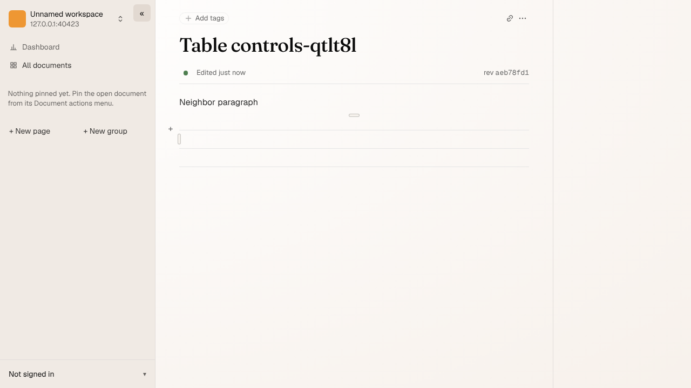
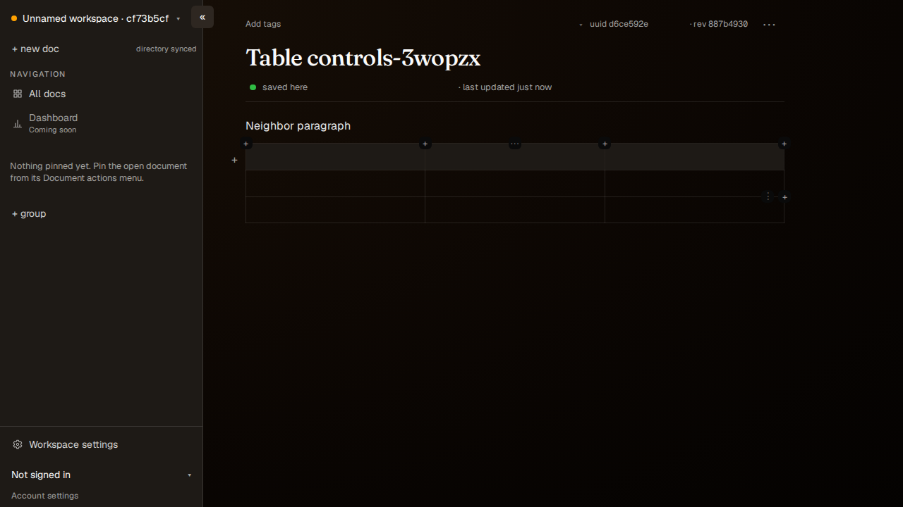

# Quiet table controls

Synthetic editable-table reference screenshots at the Chromium laptop viewport
in light and dark appearance. `table-controls.spec.ts` captures both appearances
in the run scratch directory during the light appearance interaction proof. The caret is in the
neighbouring paragraph; the pointer rests in the second row's second cell, so only that
row's pill on the left border and that column's pill on the top border show.
The owner's example document was read through MCP and was not edited.





Reproduce with:

```sh
mise run e2e -- table-controls.spec.ts table-row-drag.spec.ts table-controls-shared.spec.ts table.spec.ts
```

The tests also exercise native keyboard traversal with the pointer away,
straight pointer travel to row and column pills and their menus, the right-click
menu, row and column dragging, 44px touch targets, scrolled header-only tables,
cell navigation, undo and shared write/shape guards.
The run's PR verification names its candidate and records command results and
the comparison of existing failures with the unchanged main baseline.
